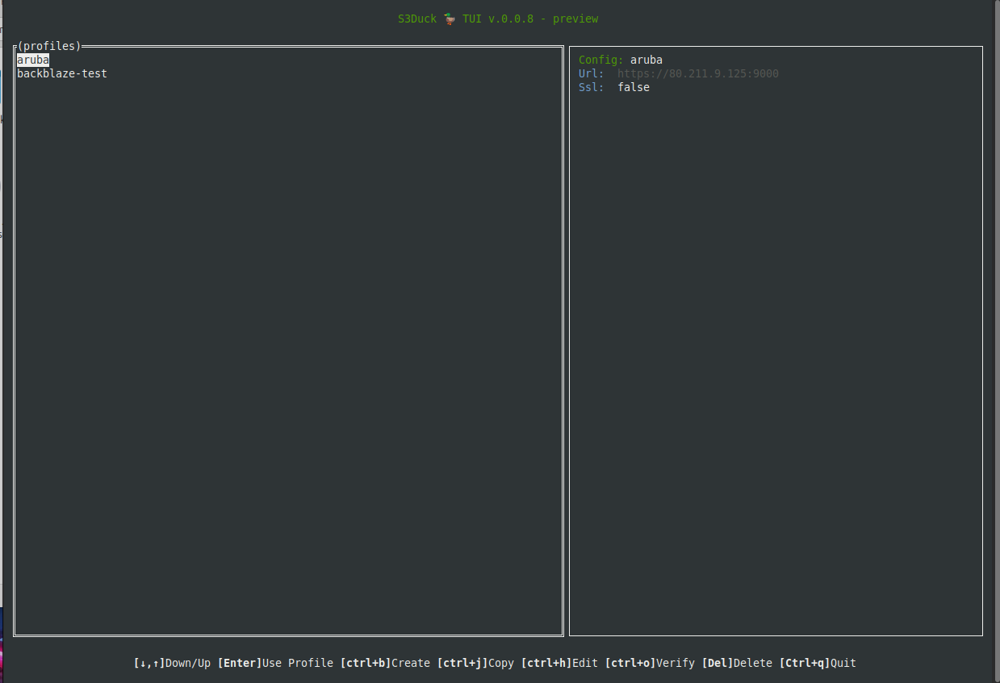
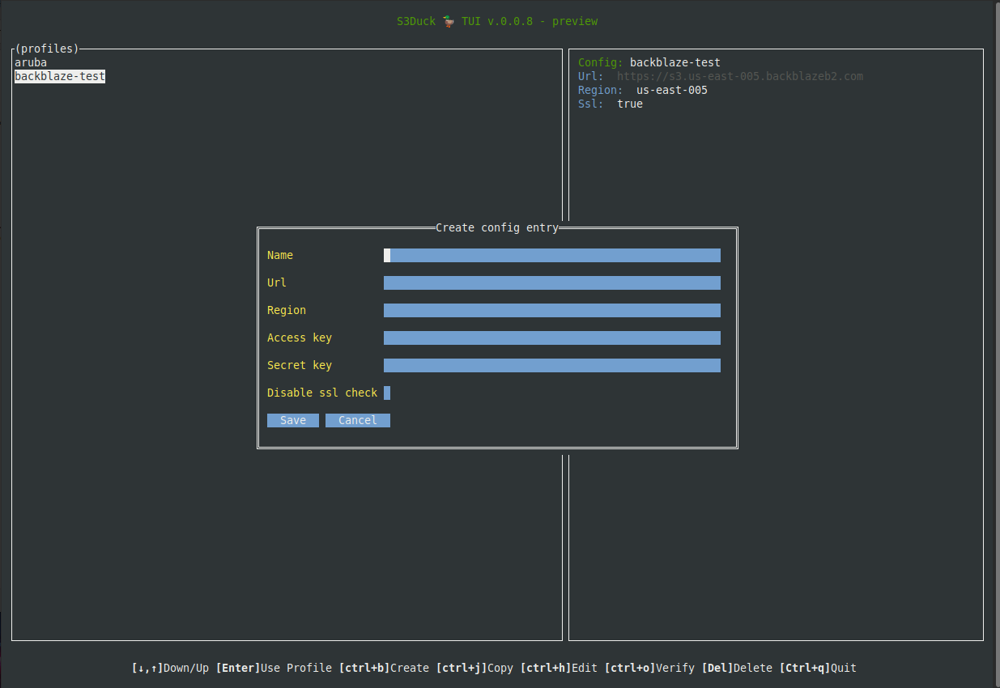
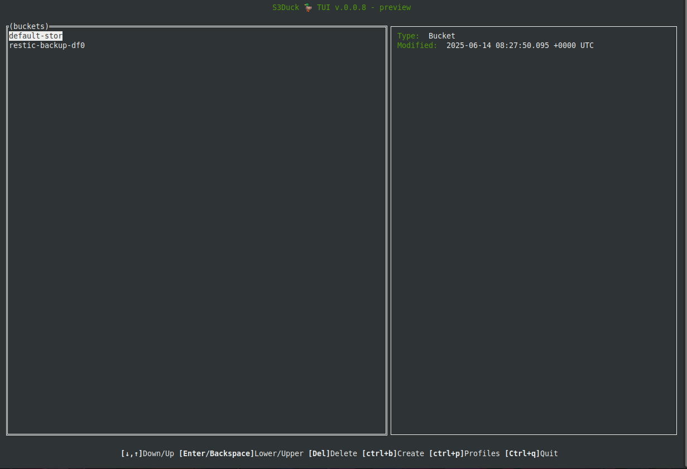
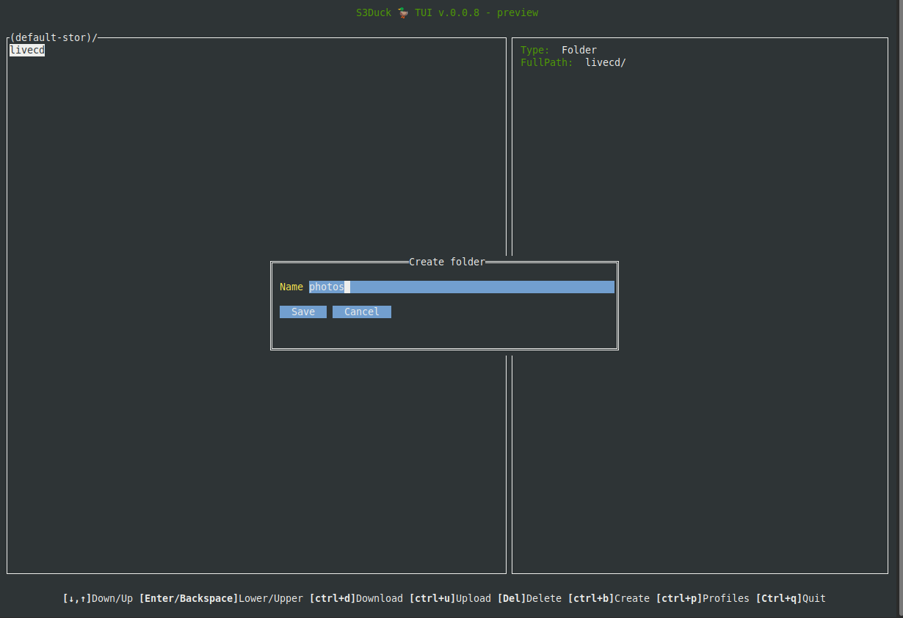
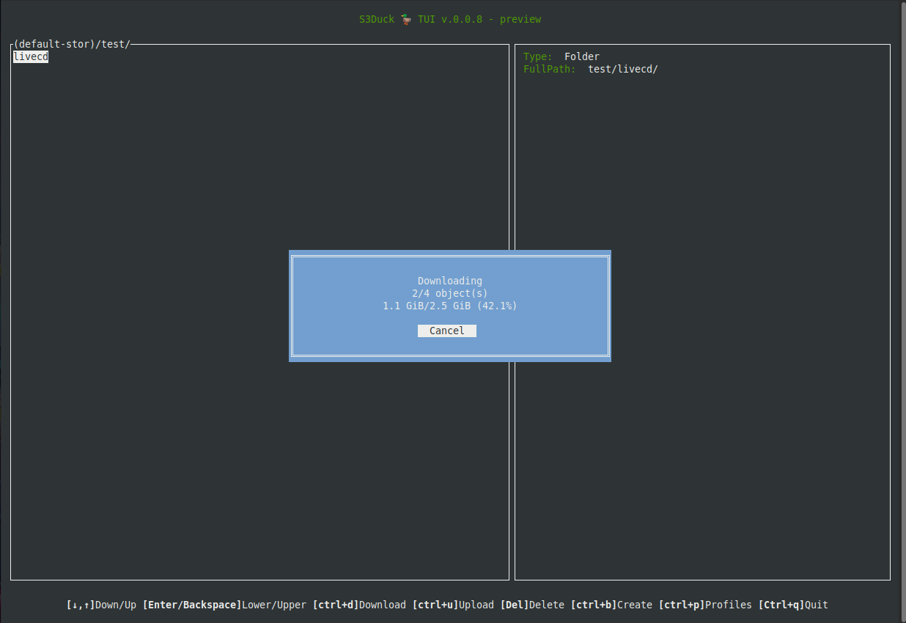
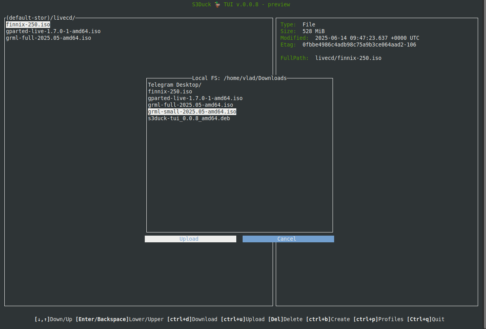
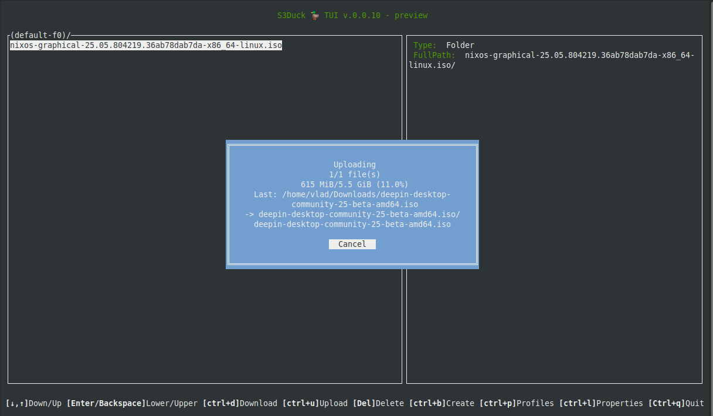

S3Duck-TUI 🦆
======

[](https://github.com/nexusriot/s3duck-tui/actions/workflows/ci.yml)

Terminal UI client for S3-compatible object storage. A TUI implementation of [S3Duck](https://github.com/nexusriot/s3duck) built in Go on top of [tview](https://github.com/rivo/tview) / [tcell](https://github.com/gdamore/tcell), using the AWS SDK for Go v2.

Works with AWS S3 and any S3-compatible service (MinIO, Ceph RGW, Yandex/VK Cloud, Backblaze B2, etc.) by pointing at a custom endpoint URL.

Features
-------------

1. Multi-profile support (create / edit / delete / clone / verify)
2. Bucket browsing with folder-style navigation (delimiter `/`), a live in-listing name filter (`/`, narrows as you type — plain text, `*.glob` or `re:regex`), and recursive search under the current prefix (Ctrl+F, same query syntax) whose results jump straight to the matching object. Listings are **streamed page by page** with a live count, stop on `Esc`, and cap at 20 000 objects per level, so a prefix with a hundred thousand keys is browsable instead of a hang
3. Bucket creation (private or public-read) and deletion
4. Folder creation (zero-byte `prefix/` markers)
5. Recursive download of files and folders with **4-worker parallel downloads**: overwrite conflicts are resolved sequentially first (Overwrite / Skip / Overwrite All / Skip All / Cancel), then approved objects download concurrently — each into a temp file of its own, renamed over the target only once the download fully succeeded, so a canceled or failed run never destroys local data; live progress shows the active file names, combined byte progress, and **transfer speed + ETA**. Files land in the local pane when one is open, else in the profile's `download_dir` (a leading `~` is expanded), else in a directory you pick
6. Multi-select for batch download, copy, move, rename and **delete** (Space, Ctrl+S all, Ctrl+X none)
7. Upload with a built-in, icon-styled local filesystem browser; preserves directory tree, creates markers for empty folders, and sends exactly the keys the overwrite check was shown. Every uploaded object gets a **derived Content-Type** (extension table first, content sniff for extensionless files), so a bucket serving a site over HTTP does not answer `application/octet-stream` to everything
8. Bucket / folder size summary (Ctrl+G)
9. Object properties (size, ETag, storage class, last modified) in the side panel; presigned (time-limited) share links for private objects (Ctrl+W, or the "Presign Link" button in properties — 15m / 1h / 24h / 7d, capped at the SigV4 7-day max)
10. Profile cloning (Ctrl+Y on the profiles screen) and system-clipboard copy of a presigned link (Ctrl+W) or a download report
11. Server-side copy / move / rename, recursive for folders, multi-select aware, **cross-bucket** (pick any destination bucket) with live object rate + ETA (Ctrl+Y copy, Ctrl+T move, Ctrl+R rename)
12. **Dual-pane (Midnight Commander style)** layout (Ctrl+O toggle, Tab to switch panes); copy/move defaults its destination to the other pane
13. **Batch / pattern rename** of multiple marked objects (Ctrl+R with >1 selected): `{name}` / `{ext}` / `{n}` tokens plus an optional find→replace
14. **Bookmarks** of bucket+prefix locations per profile (Ctrl+B) and **back/forward navigation history** (`[` / `]`, or Alt+←/→)
15. **Command palette** (Ctrl+K) — fuzzy launcher over a hand-picked list of most browser actions
16. **Per-profile bandwidth throttle** (`max_bytes_per_sec`) capping combined upload/download throughput
17. **Background transfer queue** — downloads/uploads can run in the background (the progress modal has a **Background** button); a transfers panel (`t`) shows live per-job progress/speed/ETA, cancel, and clear, with at most 2 byte-transfers running at once
18. **Object clipboard** — yank/cut objects (`y`/`x`) and paste (`p`) into any folder or the other pane (cross-bucket aware)
19. **Undo** the last move/rename (`u`), in the profile it happened in; objects a "Skip existing" left alone stay where they are
20. **Search across all buckets** (checkbox in the Ctrl+F prompt); results jump straight to the matching object in its bucket
21. **Abort incomplete multipart uploads** (`, m`) and a **read-only bucket-config dashboard** (versioning / encryption / object-lock / region) (`, b`), also in the command palette
22. **Operation activity log** — the current session in-app (`, a` or the palette), and a persistent copy on disk (see 48)
23. **Sync** (Ctrl+E) — mirror in any of three directions: local → remote, remote → local, or **remote → remote** (bucket/prefix to bucket/prefix, server-side copies). Always preceded by a mandatory dry-run plan (create / update / delete, per-file reason, total bytes); optional deletion of extraneous objects at the destination. Applied by a 4-worker pool, writes before deletes. **Exclude patterns** filter both sides before the diff (`node_modules, *.tmp, re:^\.git$`): plain text is a case-insensitive substring tested against the relative path and each of its segments (plain `.git` would also exclude `.github/`), `*` / `?` make a glob, `re:` a regex. The list is split on every comma, so a regex cannot contain one, and a pattern that does not compile stops the run instead of matching nothing. An optional **checksum comparison** replaces size+mtime with real content comparison
24. **AWS credentials, delegated or static** — name a `~/.aws` profile and the AWS SDK resolves it on every use, which makes **SSO, assume-role and `credential_process` profiles work and stay refreshed** (a stored session token cannot). Static keys with an optional `session_token` still work; `Ctrl+I` on the profiles screen imports either kind from `~/.aws/credentials` / `~/.aws/config`
25. **Sort** the listing by name / size / date, ascending or descending (`s` cycles the key, `S` reverses); **refresh** with `r` or F5
26. **Object versioning** (`v`) — full history for the selected object including delete markers; restore an old version as current (a copy to the top of the history, so nothing is lost), download any version, or permanently delete one
27. **Object metadata & tags** (`m`) — edit Content-Type / Cache-Control / Content-Disposition / Content-Encoding and `x-amz-meta-*` pairs, plus the object tag set; only the halves you actually changed are written
28. **Storage class & Glacier restore** (`c`) — move an object between storage classes in place (metadata preserved) and request a temporary restore of an archived object, with days and retrieval tier; restore state is shown in the metadata (`m`) and storage-class (`c`) dialogs
29. **Retried uploads** — the multipart uploader now backs off and retries transient failures instead of failing the whole transfer on one blip, and grows its part size with the file so S3's 10 000-part limit no longer fails an upload above 48.8 GiB at its last part
30. **Listing columns** — size, modified date and storage class alongside the name, so the sort keys order by something visible. The layout follows the pane width: columns drop (class → date → size) rather than squeezing names into uselessness, and re-flow on terminal resize
31. **Edit in `$EDITOR`** (`e`) — open a small text object in your editor (the TUI suspends while it runs) and save straight back to the bucket; Content-Type, Cache-Control and friends, user metadata, storage class and tags are all preserved. If the object changed on the server while you edited — or cannot be confirmed unchanged, because it was deleted or the check failed — the save is refused and your version is kept in a temp file (the error names it). Guarded by a 1 MiB cap and a binary sniff
32. **Cross-profile copy** (`>`) — copy the marked objects or folders to a bucket in a *different profile*, streamed through the client (GET here → PUT there), so the two sides can be entirely different endpoints (MinIO → AWS, provider migration). Content headers, metadata and tags ride along (storage class deliberately not — class names aren't portable across providers); runs as a cancellable background transfer
33. **Duplicate finder** (`D`) — scan the current prefix recursively and browse groups of identical objects (matched by size + ETag), ordered by wasted bytes; reveal any copy in the browser or delete it with a confirmation (into the trash on a safe-delete profile). The oldest copy is marked as the likely original
34. **Pane comparison** (`=`) — read-only diff of the two dual-pane bucket locations by name and size (left-only / differs / right-only), answering "are these two prefixes actually the same?" without transferring anything
35. **Overwrite confirmation for remote writes** — rename, batch rename, copy, move, paste, upload, cross-profile copy and restore-from-trash all check the destination first and name what they would replace, offering **Overwrite**, **Skip existing** (when that still leaves something to do) or **Cancel**; an upload's empty-folder markers replace no content and are not counted. Skipping a destination on a *move* leaves the source in place too, so nothing is ever deleted without having been written somewhere. Sync is exempt: its dry-run plan already lists every update before anything moves
36. **Copies above 5 GiB** — every server-side copy (copy, move, rename, paste, trash and restore, storage-class changes, metadata saves, version restores, remote → remote sync) falls back to a concurrent multipart part-copy past the size where a single-request S3 copy is rejected, carrying content headers (Content-Language, Expires and the website redirect included), metadata and tags across, encrypted by the same rule as a single-request copy (see `sse` under *Configuration*). Such a copy carries no additional checksum: `UploadPartCopy` has no way to send one
37. Custom endpoints and self-signed TLS support (`ignore_ssl`)
38. **Local pane** (`l`) — point one dual-pane side at a directory and browse it with the same columns, sort, filter and multi-select as a bucket; `Ctrl+Y` from it uploads exactly the marked files and folders to the other pane's prefix, and `Ctrl+Y` (or `Ctrl+D`) from the remote side downloads into that directory. The local pane never deletes, renames or creates: it is a transfer endpoint, not a file manager. Actions that only mean something against an object — properties, presigned links, versions, metadata and the rest — say so instead of acting on the local file
39. **Usage browser** (`G`) — one recursive listing, then drill down through the prefix tree by size: share bars, object counts and a **storage-class breakdown** at every level, `g` to jump to any node in the browser. The flat top-10 summary (Ctrl+G) now discloses what it folded away instead of truncating silently
40. **Preview** (`P`) — read-only look at the head of any object through a **ranged GET**, so previewing a 40 GiB log costs one small request; binary content is shown as a hexdump, and `e` hands the object to the editor
41. **Version diff** (`D` in the version browser) — unified diff of any old version against the current one. Bounded by line count rather than by bytes (the comparison is quadratic in lines): a pair too large to diff in memory is declined with both counts named, rather than taking the app down
42. **Read-only profiles** — a per-profile flag that refuses every mutating action, and a header that always names the open profile, its endpoint and its read-only state, so "which account is this?" is answerable without leaving the browser
43. **Safe delete (trash)** — a per-profile mode where delete, from the browser or the duplicate finder, becomes a server-side move into `.s3duck-trash/<timestamp>/`; `R` restores objects to the keys they came from — through the same overwrite confirmation as any other remote write, since the original key may hold something newer by then. Deleting a whole bucket, a version or something already in the trash, and emptying the trash, are real deletes; a sync leaves the trash prefix out of both sides, so its delete-extraneous pass (whose deletes are real) never reaches it
44. **Checksums** — ask S3 to verify a `CRC32C` / `CRC32` / `SHA256` / `SHA1` checksum on writes (all but copies above 5 GiB), verify a downloaded file against it automatically or on demand (`V`), and get a straight answer where no comparison is possible: a multipart object's checksum-of-parts and the ETag of an SSE-KMS object are reported as not verifiable rather than as a mismatch. Optional per-profile **server-side encryption** (SSE-S3 / SSE-KMS)
45. **Retry failed / export list** — download, upload, copy, move, paste, sync, delete and batch rename keep their failures and can write the full list to a file instead of showing the first eight and forgetting the rest; all of them but upload, which stops at its first error, also offer **Retry failed** for exactly those units. Restore from the trash exports but does not retry; cross-profile copy names the first eight failures and offers neither, and undo lists its failures with neither
46. **Background transfer notices** — a header badge while transfers run, plus a transient notice and a terminal bell when a backgrounded one finishes (no bell for one you cancelled); no modal steals focus from what you moved on to
47. **Configurable keymap** — every browser-screen action has a name (see *Action names*) and can be rebound in `~/.config/s3duck-tui/keys.json`, with a **leader key** (`,`) opening a second namespace; the in-app hotkey panel is generated from the live keymap, so it cannot drift from what the keys do
48. **Persistent activity log** — operations are recorded in `~/.local/state/s3duck-tui/activity.log` (rotated at 2 MiB) alongside the in-session view, multi-item deletes, copies, moves and syncs as one line of counts rather than one per key; and each profile reopens where it was last browsing (saved on `Ctrl+P` and on quit)
49. Linux (amd64/arm64/armv7/riscv64), FreeBSD and macOS / Windows builds (statically linkable)

Screenshots
-------------









Architecture
-------------

The project is layered by **testability seam**: what a package is allowed to
depend on decides what can be asserted about it. `internal/session`, `internal/jobs`
and `internal/ops` know nothing about the terminal; `internal/ui/*` is the only
place that touches tview; `internal/model` is the only place that touches the
network.

```
                        +-----------------------------+
                        |    cmd/s3duck-tui/main.go   |
                        +--------------+--------------+
                                       |
                                       v
       +----------------------------------------------------------------+
       |                      internal/controller                       |
       |        screen wiring: keymap, action table, navigation         |
       |         (controller.go = browser, profiles.go = list)          |
       +--+-------------+------------+-------------+----------------+---+
          |             |            |             |                |
          v             v            v             v                v
   +-------------+ +----------+ +---------+ +--------------+ +-------------+
   |   session   | |    ops   | |   jobs  | |  internal/ui | |   config    |
   |  Pane:      | | Download | | Queue,  | |  shell   -+  | | ~/.config/  |
   |  location,  | | Upload   | | badge,  | |  widgets  |  | | s3duck-tui/ |
   |  listing,   | | Copy     | | notices | |  flows    |  | | config.json |
   |  selection, | | Sync     | |         | |  screens  |  | +-------------+
   |  filter,    | | over     | |         | |           |  |
   |  history    | | narrow   | |         | |           |  |
   |             | | ports    | |         | |           |  |
   +------+------+ +----+-----+ +---------+ +-----------+--+
          |             |                               |
          +------+------+                               v
                 |                             +-----------------+
                 v                             |      tview      |
       +-------------------+                   +-----------------+
       |   internal/model  |
       |  AWS SDK v2 wrap  |
       +---------+---------+
                 |
                 v
       +-------------------+
       |  internal/utils   |
       |  SplitFunc,       |
       |  RandStr,         |
       |  CopyToClipboard  |
       +-------------------+
```

The arrows are the layering, not every import: the controller also calls
`internal/model` and `internal/utils` directly, and `internal/ui/flows` drives
`internal/ops` and `internal/jobs`.

`internal/ops` holds the long-running operations (download, upload, copy/move,
sync) as plain values over narrow interfaces, so their orchestration —
overwrite decisions, the worker pool, cancellation, verification, the retry
set — is unit-tested against a fake store rather than a live endpoint. `internal/ui/flows` holds the
single runner that drives any of them: confirmation, job registration, the
Background/Cancel modal, the progress throttle and the summary, written once.
`internal/ui/shell` owns every overlay (handles, not page names) and the UI
update queue that never blocks. See [REFACTOR.md](REFACTOR.md).

### Packages

| Path | Responsibility |
| --- | --- |
| `cmd/s3duck-tui/main.go` | Thin entrypoint: instantiates the controller and runs the tview app loop. |
| `internal/controller` | Application state and event handling. Owns the action table, modal flows (create/edit profile, create bucket/folder, download, upload, overwrite prompt, summary, delete confirmation), listing order, selection scoping per `bucket:path`, and goroutine→UI marshalling. Split by feature: `sync.go` (directory sync), `objectmeta.go`, `versions.go`, `duplicates.go`, `crossprofile.go`, `columns.go`, `edit.go`, `overwrite.go`, plus `keymap.go` (bindings as data), `listing.go` (streamed, cancellable listings), `opresult.go` (the failure ledger behind the delete, batch-rename and trash-restore reports; everything the runner drives reports through `ops.Result`), `localpane.go` (the local-filesystem pane), `usage.go` (the du browser), `preview.go` (preview + version diff), `match.go` (the text/glob/regex query used by the filter, the search and sync excludes), `guard.go` (read-only and profile identity), `trash.go`, `verify.go`, `notify.go`, `audit.go` and `options.go`. |
| `internal/session` | One browser pane: location (bucket, prefix, local dir), object map, selection sets per listing scope and filter, all behind one mutex, plus the back/forward history, which only the UI goroutine touches and so has no lock. The controller holds `panes [2]*session.Pane`; navigations, listings and transfers capture what they act on — the pane, or its bucket — on the UI goroutine, so a `Tab` cannot redirect them. No tview. |
| `internal/ops` | Long-running operations (`Download`, `Upload`, `Copy` for copy and move, `Sync`) as values implementing `Operation`. They depend only on narrow ports (`Fetcher`, `Pusher`, `Checker`, `FS` and `Gate` in `ports.go`, `Mover` in `copy.go`; declared consumer-side and satisfied by `*model.Model`; `Pusher` is `UploadTargets`, which sends exactly the list it is given) and on a `Reporter` they emit progress and questions through — so an overwrite prompt is a value, not a call into tview. Unit-tested against a fake store. No tview. |
| `internal/jobs` | The background transfer queue: `Job`/`Queue`/`View`, the concurrency gate, the header's transfer badge and the completion notices. No tview. |
| `internal/ui/shell` | Every overlay and every UI update made off the UI goroutine. `Push` returns a `*Layer` whose page name nobody else holds, so two flows cannot destroy each other's modal; `Do` appends to a pending list and returns, so it never blocks from any goroutine (`QueueUpdateDraw` waits on the event loop, and calling it *from* the event loop deadlocks). |
| `internal/ui/flows` | The single `Runner` that drives any `ops.Operation`: confirmation, job registration, the Background/Cancel progress modal, the redraw throttle, and the summary with its Retry and Export buttons. Plus the pure rate/ETA and report-text helpers. |
| `internal/ui/screens` | Self-contained overlay screens that own their own widgets — currently the transfers panel. |
| `internal/ui/widgets` | Pure tview construction. Builds the main flex layout (object list + details panel), modal helper, profile form, local-file browser, hotkeys / about pop-ups. Contains the version string. |
| `internal/model` | S3 layer (`model.go` plus `sync.go`, `object.go`, `versions.go`, `copy.go`, `content.go`, `conflicts.go`, `write.go` for per-profile write options and MIME derivation, `checksum.go` for integrity, `local.go` for the local pane's listings and upload expansion). Wraps `s3.Client`, `s3manager.Downloader/Uploader`, custom endpoint resolver, a static-credentials provider (or, with `aws_profile`, the SDK's own resolution through `WithSharedConfigProfile`), and TLS skip-verify. Exposes high-level operations: `List` / `ListStream`, `ListBuckets`, `ListObjects` / `ListObjectsStream`, `DownloadTarget`, `SafeLocalPath`, `Upload` / `PrepareUpload` / `UploadTargets`, `CopyObject` / `CopyObjectSized`, `CopyKeys` / `MoveKeys`, `Conflicts` / `PlannedCopyKeys`, `CrossCopy`, `GetObjectContent` / `PutBytes` / `CurrentETag`, `HeadObject`, `PutObjectMeta`, `ObjectTags` / `PutObjectTags`, `SetStorageClass`, `RestoreObject`, `ListVersions`, `RestoreVersion`, `DeleteVersion`, `DownloadVersion`, `GetVersionContent`, `GetObjectHead`, `ObjectChecksum` / `VerifyLocalFile` / `LocalChecksum` / `RemoteChecksums`, `MimeForName` / `MimeForFile`, `WalkDir` / `LocalTargets`, `ResolveDownloadObjects`, `Delete`, `DeleteKey`, `DeleteBucket`, `UploadFile`, `WalkLocal`, `ListRemoteEntries`, `EmptyBucket`, `CreateBucket`, `CreateFolder`, `MakeBucketPublic`, `BucketConfig`, `ListMultipartUploads` / `AbortMultipartUpload`, `PresignGetURL`, `GetBucketLocation`, `RefreshClient`, `NormalizePrefix`. The calls that reach S3 take a `context.Context`, except `CreateBucket`, `DeleteBucket`, `CreateFolder`, `MakeBucketPublic`, `BucketConfig`, `GetBucketLocation`, `RefreshClient`, `PresignGetURL` and the multipart-upload listing/abort. Taking one is not the same as being cancellable: some short controller flows still pass `context.Background()` (a single rename, metadata and storage-class rewrites, version actions, the editor's save, the overwrite pre-scans). Implements `progressReader` / `progressWriterAt` for live byte-count progress. |
| `internal/utils` | Small helpers: path-split rune predicate (`SplitFunc`), random string (`RandStr`), clipboard write (`CopyToClipboard`). |
| `internal/config` | JSON profile storage in `~/.config/s3duck-tui/config.json` — load, write, append, copy, delete, and `SaveLocation`, which patches only one profile's `last_bucket` / `last_prefix` on disk and never writes a config that failed to load; auto-creates the directory (`0700`) and file (`0600`) on first run. An explicit save over an unreadable file first moves it aside to `config.json.bak` (then `.bak.1`, `.bak.2`, …, never overwriting an earlier backup). `awsshared.go` parses `~/.aws/credentials` / `~/.aws/config` for the profile import. |
| `e2e` | The end-to-end suite (build tag `e2e`): builds the real binary, drives it in a tmux session per test against MinIO, and asserts on what the server and the disk hold. `docker-compose.yml`, `Dockerfile` and `run.sh` make it hermetic (`make e2e`). |

### Data flow

1. **Startup** — `main` builds a `Controller`, which builds a `View` and loads `Params` from `internal/config`. The profile list is rendered first.
2. **Open profile** — selecting a profile goes through `modelConfigFor` (the single place a stored profile becomes a connection: credentials, throughput cap, write options) and `model.NewModel`, which builds the AWS config — custom endpoint resolver, then either static credentials or the SDK's own resolution for the profile's `aws_profile`, plus a per-phase-timeout HTTP client with optional `InsecureSkipVerify`. If the profile remembers a location, it is reopened there.
3. **Browse** — selecting a bucket triggers `RefreshClient` (resolves bucket region via `GetBucketLocation`, rebuilds the client; on failure the old client stays). Subsequent navigation uses `ListStream(ctx, prefix, bucket, onPage)` with `Delimiter="/"`, rendering folders + files as pages arrive; `Esc` cancels and whatever arrived stays browsable. A pane pointed at a local directory reads it with `WalkDir` instead.
4. **Transfer** — long-running operations (download / upload / copy / sync, and the delete / scan flows) run in goroutines with a `context.Context` that the cancel button on the progress or wait modal can cancel. Progress is reported through `shell.Do`, which never blocks whichever goroutine calls it; failures accumulate in an `ops.Result` (download, upload, copy/move, sync) or, for delete, batch rename and trash restore, an `opResult`, so the final report can export them and, where a retry makes sense, re-run exactly what failed.
5. **Selection scope** — multi-select state is keyed by `bucket:path`, so selections survive navigation in and out of folders.
6. **Sync** — `Ctrl+E` scans both sides (local tree and/or remote prefixes), drops anything matching the run's exclude patterns, optionally resolves per-file checksums, diffs them with the pure `planSync`, shows the resulting plan, and only then applies it through the same transfer-job machinery as downloads and uploads. `=` runs the same diff read-only across the two panes, by name and size only.

### Configuration

Profiles live in `~/.config/s3duck-tui/config.json` as a JSON array of:

```json
{
  "name":         "minio-local",
  "base_url":     "https://s3.example.com",
  "region":       "us-east-1",
  "access_key":   "AKIA...",
  "secret_key":   "...",
  "session_token": "",
  "ignore_ssl":   false,
  "download_dir": "~/Downloads/s3",
  "max_bytes_per_sec": 0,
  "bookmarks": [{"name": "photos/2024/", "bucket": "photos", "prefix": "2024/"}]
}
```

`region` is optional for non-AWS endpoints, and is what requests are signed with until a bucket is entered. Entering a bucket, on any endpoint, asks `GetBucketLocation` for that bucket's region and rebuilds the client for it (for an `amazonaws.com` URL, on the SDK's regional endpoint rather than `base_url`); the client keeps that region afterwards, bucket creation included. If the lookup fails, the client keeps the region it had and an error toast says so — on a backend without `GetBucketLocation`, at every bucket entry. `download_dir` is optional: without it `Ctrl+D` asks with a directory picker each time (an open local pane takes precedence either way), while verify (`V`, which looks for the local copy there), version downloads, Export list and the sync form's default use `~/Downloads`, and a new local pane opens there if it exists. A leading `~` is expanded to the user's home directory. `max_bytes_per_sec` (0 = unlimited) caps combined upload/download throughput. `bookmarks` are managed in-app (Ctrl+B); both fields are omitted from the file when unset. `session_token` is only needed for static temporary credentials and is easiest to obtain via **Ctrl+I → import from `~/.aws`** on the profiles screen; it is omitted when empty. Note that `secret_key` and `session_token` are stored in plaintext (the file is `0600`).

#### Per-profile options (`o` on the profiles screen)

Behaviour settings live on a second form, because the connection form is
already as tall as a small terminal can show:

```json
{
  "aws_profile":       "sso-dev",
  "read_only":         true,
  "trash":             true,
  "trash_prefix":      ".s3duck-trash/",
  "no_mime_detect":    false,
  "sse":               "aws:kms",
  "sse_kms_key_id":    "arn:aws:kms:...",
  "checksum_algo":     "CRC32C",
  "verify_downloads":  true,
  "last_bucket":       "reports",
  "last_prefix":       "2026/"
}
```

- **`aws_profile`** delegates credentials to the AWS SDK's own resolution for
  that `~/.aws` profile instead of the static keys. This is what makes SSO,
  assume-role and `credential_process` profiles usable — and what keeps them
  refreshed. Nothing is stored here but the profile's name.
- **`read_only`** refuses every write for this profile (delete, upload, copy,
  move, rename, paste, undo, metadata, storage class, version restore/delete,
  sync to remote, trash operations). Browsing, searching and downloading still
  work, and the header shows `[READ-ONLY]` in red.
- **`trash`** turns delete — the browser's and the duplicate finder's — into a
  server-side move under `trash_prefix` (default `.s3duck-trash/`), inside a
  timestamped folder that preserves the original key. `R` restores, asking
  first if the original key is occupied again. Deleting a whole bucket, a
  version or something already in the trash, and emptying the trash, delete
  for real; a sync drops the trash prefix from both sides, so its
  delete-extraneous pass (real deletes too) never reaches it.
- **`no_mime_detect`** switches off Content-Type derivation on upload, for
  buckets whose types are managed elsewhere.
- **`sse`** / **`sse_kms_key_id`** encrypt what this app writes (`AES256` or
  `aws:kms`): uploads, edits, folder markers, cross-profile copies (with the
  destination profile's setting) and every server-side copy, single-request or
  multipart. Without them a copy gets the destination bucket's default, except
  a same-bucket copy whose source headers were read first (a single object, a
  metadata or storage-class rewrite, a version restore, anything above 5 GiB),
  which keeps the source's encryption; copies up to 5 GiB sized from a folder
  listing or a sync plan skip that read and get the bucket default.
- **`checksum_algo`** asks S3 to verify an additional checksum on uploads,
  edits, folder markers, cross-profile copies and single-request copies — not
  on multipart copies above 5 GiB, because `UploadPartCopy` cannot send one.
- **`verify_downloads`** re-reads each downloaded file and compares it against
  the object's whole-object checksum or, failing that, its ETag when that is a
  plain MD5 (single-part, not SSE-KMS). A multipart object's checksum-of-parts
  and an SSE-KMS object's ETag are reported as not verifiable rather than as a
  mismatch.
- **`last_bucket`** / **`last_prefix`** are saved when you leave the profile
  with `Ctrl+P` and when you quit with `Ctrl+Q` — not on every navigation, and
  not on `Ctrl+C`, which exits without saving — so the profile reopens where it
  was left (on the bucket list they are cleared; with the local pane active the
  previous location is kept). The save re-reads `config.json` and rewrites
  only these two fields of that one profile, so it neither clobbers what
  another running instance saved nor writes over a config that failed to load.

#### Keymap (`~/.config/s3duck-tui/keys.json`)

Every browser-screen action has a name (see *Action names* below); the file
rebinds any of them. A missing file means the defaults, a malformed one is
reported at startup and ignored, and a binding that cannot be used leaves that
action's default in place.

```json
{
  "leader": ",",
  "keys": {
    "preview": "z",
    "usage": "Ctrl+J",
    "delete": ""
  },
  "leader_keys": {
    "activity-log": "L"
  }
}
```

`keys` sets an action's direct chord and `leader_keys` its chord behind the
leader; setting either drops that action's default in the same namespace, so a
rebind never leaves the old key working too. `usage` and `verify` ship with one
of each, and any action may be given either.

A chord is one character or one key name, optionally with modifiers. `Alt+`
combines with anything. `Ctrl+` works only with a letter (`Ctrl+J`,
`Ctrl+Alt+J`). `Shift+<letter>` is that letter's upper case (`Shift+s` is `S`)
and is refused on anything else — write the shifted character itself (`>`,
not `Shift+.`). The key names are `Enter`, `Esc`/`Escape`, `Tab`, `Backtab`,
`Backspace`, `Del`/`Delete`, `Insert`, `Home`, `End`, `PgUp`, `PgDn`,
`Up`/`Down`/`Left`/`Right` and `F1`–`F12`, plus `Space` for the space
character; only `Alt+` combines with a key name (`Alt+Left`), and `Ctrl+` or
`Shift+` on one is refused with a warning. Modifiers and key names are
case-insensitive. An empty chord unbinds the action. Binding a chord another
action already holds takes it over, with a startup warning, and the other
action loses that key. The leader key (default `,`, changed with `"leader"`)
prefixes the second namespace, and pressing it shows what it offers in the
header.

##### Action names

The names `keys.json` accepts, with their default chords (the hotkey panel
shows chords and descriptions, not these names). The `-alt` actions are second
keys for the same command, so each can be rebound or unbound on its own.

| Action | Default key | Does |
| --- | --- | --- |
| `up` | `Backspace` | Go up one level (`..`) |
| `toggle-select` | `Space` | Mark / unmark the highlighted item |
| `select-all` | `Ctrl+S` | Mark everything visible |
| `clear-selection` | `Ctrl+X` | Clear the marks |
| `filter` | `/` | Filter the listing live |
| `cancel-listing` | `Esc` | Stop a running listing (otherwise Esc passes through) |
| `refresh` | `r` | Re-list from the server |
| `refresh-alt` | `F5` | Re-list from the server |
| `sort-key` | `s` | Cycle the sort key: name / size / date |
| `sort-dir` | `S` | Reverse the sort |
| `download` | `Ctrl+D` | Download |
| `upload` | `Ctrl+U` | Upload through the local file browser |
| `delete` | `Delete` | Delete (into the trash on a safe-delete profile) |
| `create` | `Ctrl+N` | New bucket / folder |
| `rename` | `Ctrl+R` | Rename; pattern rename when several are marked |
| `copy` | `Ctrl+Y` | Copy to a bucket + prefix; uploads from a local pane, downloads into one |
| `move` | `Ctrl+T` | Move to a bucket + prefix |
| `yank` | `y` | Copy to the object clipboard |
| `cut` | `x` | Cut to the object clipboard |
| `paste` | `p` | Paste the object clipboard here |
| `undo` | `u` | Undo the last move / rename |
| `search` | `Ctrl+F` | Recursive search |
| `properties` | `Ctrl+L` | Object properties |
| `presign` | `Ctrl+W` | Presigned share link |
| `summary` | `Ctrl+G` | Size summary |
| `usage` | `G`, leader `u` | Usage browser |
| `preview` | `P` | Preview (ranged GET) |
| `verify` | `V`, leader `v` | Verify the local copy against the object |
| `versions` | `v` | Version history |
| `metadata` | `m` | Metadata and tags |
| `storage-class` | `c` | Storage class / Glacier restore |
| `edit` | `e` | Edit in `$EDITOR` |
| `duplicates` | `D` | Find duplicates |
| `sync` | `Ctrl+E` | Sync |
| `compare-panes` | `=` | Compare the two panes |
| `cross-profile-copy` | `>` | Copy to another profile |
| `bookmarks` | `Ctrl+B` | Bookmarks |
| `palette` | `Ctrl+K` | Command palette |
| `transfers` | `t` | Transfers panel |
| `history-back` | `[` | History back |
| `history-forward` | `]` | History forward |
| `history-back-alt` | `Alt+Left` | History back |
| `history-forward-alt` | `Alt+Right` | History forward |
| `dual-pane` | `Ctrl+O` | Toggle dual pane |
| `swap-pane` | `Tab` | Switch pane (dual-pane) |
| `local-pane` | `l` | Point the other pane at a local directory, or back |
| `profiles` | `Ctrl+P` | Back to profiles |
| `hotkeys` | `Ctrl+H` | Hotkeys panel |
| `about` | `Ctrl+A` | About |
| `quit` | `Ctrl+Q` | Quit (`Ctrl+Q` itself always quits, see *Hotkeys*) |
| `trash-restore` | `R` | Restore the marked items from the trash |
| `trash-empty` | leader `t` | Empty the trash |
| `activity-log` | leader `a` | Activity log |
| `bucket-config` | leader `b` | Bucket configuration |
| `abort-uploads` | leader `m` | Abort incomplete multipart uploads |

#### Activity log

Operations are appended to `$XDG_STATE_HOME/s3duck-tui/activity.log` (default
`~/.local/state/s3duck-tui/activity.log`, mode `0600`, rotated once at 2 MiB)
as `timestamp<TAB>profile<TAB>message`. Multi-item deletes, copies, moves,
batch renames and syncs write one line of counts rather than one per key, and
keymap warnings are recorded here too. The in-app view (`, a` or palette →
*Activity log*) still shows the current session only.

Hotkeys
-------------

`Ctrl+H` opens the in-app list of these. It scrolls (↑/↓, PgUp/PgDn, Home/End,
`j`/`k`) and sizes itself to the terminal, so the tail of the list is reachable
on a short one; `Esc`, `q` or `Ctrl+H` closes it.

**Profiles screen**

| Key | Action |
| --- | --- |
| ↑ / ↓ | Navigate |
| Enter | Open profile |
| Ctrl+N | Create profile |
| Ctrl+I | Import a profile from `~/.aws/credentials` / `~/.aws/config` |
| Ctrl+E | Edit profile (connection) |
| o | Per-profile options (credentials source, read-only, trash, SSE, checksums) |
| Ctrl+Y | Copy / clone profile |
| Ctrl+V | Verify profile (test connection) |
| Del | Delete profile |
| Ctrl+H | Hotkeys help |
| Ctrl+A | About |
| Ctrl+Q | Quit |

**Browser screen**

| Key | Action |
| --- | --- |
| ↑ / ↓ | Navigate |
| Enter | Open folder / bucket |
| Backspace | Go up (`..`) |
| / | Filter the current listing live — text, `*.glob` or `re:regex` (Enter keeps it, Esc clears) |
| Esc | Stop a running listing (what has arrived stays browsable) |
| s / S | Sort: cycle name → size → date / reverse the direction |
| r / F5 | Refresh the current listing |
| Ctrl+F | Recursive search under the current prefix; Enter reveals a hit |
| Ctrl+O | Toggle dual-pane (Midnight Commander style) |
| Tab | Switch active pane (dual-pane) |
| Ctrl+B | Bookmarks — go to / add current / remove |
| Ctrl+K | Command palette (incl. abort incomplete uploads, bucket config, activity log) |
| [ / ] | History back / forward (also Alt+← / Alt+→) |
| y / x / p | Clipboard: copy / cut / paste objects |
| u | Undo last move/rename |
| t | Transfers panel (background download/upload jobs) |
| Ctrl+P | Back to profiles |
| Ctrl+N | Create bucket / folder |
| Ctrl+D | Download current item or all selected (4-worker parallel) |
| Ctrl+U | Open local FS browser to upload |
| Ctrl+E | Sync: local ⇄ this prefix, or this prefix → another bucket/prefix (dry-run plan first) |
| = | Compare the two panes (dual-pane, read-only) |
| D | Find duplicates under this prefix (size + ETag); Enter reveals, d deletes a copy |
| e | Edit the highlighted object in `$EDITOR` (small text objects) |
| > | Copy marked objects/folders to a bucket in another profile (streams cross-endpoint) |
| Ctrl+G | Bucket / folder size summary |
| Space | Toggle selection on item |
| Ctrl+S | Select all visible |
| Ctrl+X | Unselect all |
| Ctrl+R | Rename highlighted object, or batch/pattern rename when >1 marked |
| Ctrl+Y | Copy selected / marked objects to a destination bucket + prefix (cross-bucket) |
| Ctrl+T | Move selected / marked objects to a destination bucket + prefix (cross-bucket) |
| Ctrl+L | Object properties (name, size, modified, ETag, link) |
| v | Version history — restore / download / permanently delete a version |
| m | Edit object metadata and tags |
| c | Change storage class, or request a Glacier restore |
| Ctrl+W | Copy presigned (time-limited) share link to clipboard |
| Del / Delete | Delete marked objects, or the highlighted one (recursive for prefixes; into the trash on safe-delete profiles) |
| l | Point the other pane at a local directory (`Ctrl+Y` uploads from it) |
| P | Preview the highlighted object (ranged GET; hexdump for binaries) |
| G | Usage browser — drill down by size, with a storage-class breakdown |
| V | Verify the local copy against the object's checksum |
| R | Restore the marked items from the trash (safe-delete profiles) |
| , | Leader key — press it, then one of the keys it lists in the header |
| Ctrl+H | Hotkeys help (generated from your keymap) |
| Ctrl+A | About |
| Ctrl+Q | Quit |

**Leader namespace** — press `,` (the leader), then one of:

| Key | Action |
| --- | --- |
| , a | Activity log |
| , b | Bucket configuration (versioning / encryption / object lock / region) |
| , m | Abort incomplete multipart uploads |
| , t | Empty the trash (safe-delete profiles) |
| , u | Usage browser (same as `G`) |
| , v | Verify the local copy (same as `V`) |

Pressing the leader lists its namespace in the header, so it needs no memorising.

The browser-screen and leader bindings above are defaults: each belongs to a
named action (see *Action names* under *Configuration*) that
`~/.config/s3duck-tui/keys.json` can rebind, and `Ctrl+H` shows the list as it
is actually bound. The rest is fixed: the profiles screen's keys, and the list
widget's own ↑/↓, Enter, PgUp/PgDn and Home/End. `Ctrl+Q` is caught before the
keymap on both screens, so it always quits: rebinding `quit` adds a key rather
than moving it, unbinding it removes nothing, and binding `Ctrl+Q` to another
action has no effect.

Testing
-------------

```
make test          # unit tests
make test-race     # unit tests with the race detector
make check         # gofmt, vet (all three tag sets), build, race tests
make staticcheck   # the remaining lint CI runs (needs staticcheck installed)
```

The unit suite needs no network: it covers the pure functions (planners,
matchers, formatters, parsers) plus a set of guards that assert the code still
matches what is written down — every default key binding appears in the hotkey
tables above, every table key is really bound, every profile field is
documented, the `keys.json` example names real actions, every action name
appears in the *Action names* table (and that table names no others), every
backticked `internal/…` or `cmd/…` path the docs name still exists, the version
the app reports matches the one the Makefile and `build-deb.sh` package, and no
confirmation handler in `internal/controller` compares the dialog's button
label to a hand-typed OK literal. The last three exist because each guards
something stated in more than one place that had already drifted once.

Behaviour that can only be observed against a real server lives in a tag-gated
integration suite, in two halves. `internal/model` covers the S3 calls
themselves: that restoring a version *adds* one rather than rewinding, that a
storage-class change preserves metadata, that an uploaded object's stored
Content-Type is the derived one, that a checksum round-trips and a tampered
file is caught, that a multipart object's checksum is not mistaken for a
mismatch, that an upload sends exactly its target list, that a prefix delete
takes the subtree and not the sibling sharing its name stem, and that a
presigned link actually fetches.
`internal/controller` covers the flows the app *composes* out of those calls —
a full sync (scan both sides, diff, apply, and confirm the destination mirrors
the source, deletes included) and safe delete's round trip through the trash.
Those are not model calls, so the model suite cannot see them; they are also
where the decisions that can lose data live.

```
make test-integration     # starts a throwaway MinIO in Docker, runs, tears down
```

To point it at an endpoint you already have:

```
S3DUCK_TEST_ENDPOINT=https://s3.example.com \
S3DUCK_TEST_ACCESS_KEY=... S3DUCK_TEST_SECRET_KEY=... \
make test-integration-run
```

Without `S3DUCK_TEST_ENDPOINT` the integration tests skip, so a tagged run on a
machine with no server is a no-op rather than a failure.

Neither suite presses a key. The end-to-end suite (`e2e/`, build tag `e2e`)
does: it builds the real binary, runs it in a real terminal (a tmux session per
test), types at it, reads the screen back, and then checks what MinIO and the
disk actually hold. Each test gets its own HOME (config, downloads, activity
log), its own tmux server and its own bucket. The scenarios are the ones where
a dialog's answer decides what happens to data:

- browse, download one object, quit — the exit save records the location and
  rewrites nothing else in the profile list
- rename, then undo
- a move answered with *Skip existing*, then undone — file and folder variants;
  the kept source and the kept destination must both survive
- the local pane uploads exactly the highlighted file, or exactly the marked
  ones — never the directory they sit in
- a `config.json` that fails to parse is reported and left byte-for-byte alone
- a folder delete spares the sibling that shares its name stem
- Ctrl+N creates the folder marker
- a local → remote sync with delete-extraneous and an exclude, on a safe-delete
  profile: the mirror matches, the excluded paths survive on both sides, and
  the trash is untouched

```
make e2e                  # everything in Docker: MinIO + a runner with Go and tmux
make e2e E2E_RUN=Undo     # a go test -run pattern
```

`make e2e` is hermetic: MinIO (on a tmpfs) and the runner share a private
compose network with no published ports, the working tree is mounted
read-only, and everything is torn down afterwards, pass or fail
([e2e/docker-compose.yml](e2e/docker-compose.yml), [e2e/run.sh](e2e/run.sh)).
To drive an endpoint you already have from the host instead (Go and tmux
needed), set `S3DUCK_TEST_ENDPOINT` and run
`go test -tags e2e -count=1 -v ./e2e/`; `S3DUCK_E2E_BINARY` runs the suite
against a prebuilt binary rather than the working tree — which is how each data
scenario was checked to fail against the code from before the fix it pins.

[CI](.github/workflows/ci.yml) runs the lint/unit job, the MinIO integration
job, the end-to-end job, and a cross-build matrix covering every platform the
Makefile ships binaries for.

Building
-------------

```
go build ./cmd/s3duck-tui
```

Statically linked (no libc dependency):

```
go build -ldflags "-linkmode external -extldflags -static" ./cmd/s3duck-tui
```

Building a deb package
-------------

What it takes: Go (the version `go.mod` names, 1.23 or newer) and `dpkg-deb`,
which ships with `dpkg` on any Debian or Ubuntu system. `build-deb.sh` links a
native-architecture binary statically through the C toolchain, so it also
wants `build-essential`; cross-architecture builds, and the Makefile's `deb-*`
targets, build with CGO off and need nothing more.

```
sudo apt-get install dpkg build-essential
```

Build (amd64 by default):

```
./build-deb.sh          # amd64
./build-deb-arm64.sh    # arm64
./build-deb.sh riscv64  # riscv64
```

Or via the Makefile, which builds all four:

```
make debs
```

Building a FreeBSD binary
-------------

```
GOOS=freebsd GOARCH=amd64 go build ./cmd/s3duck-tui
```

Building for RISC-V (LicheeRV Nano)
-------------

CGO is off for every cross target, so riscv64 needs no extra toolchain:

```
make licheerv           # static binary into dist/
make deb-riscv64        # riscv64 .deb into build/
./build-licheerv.sh     # same binary, standalone script
```

License
-------------

See [LICENSE](LICENSE).
